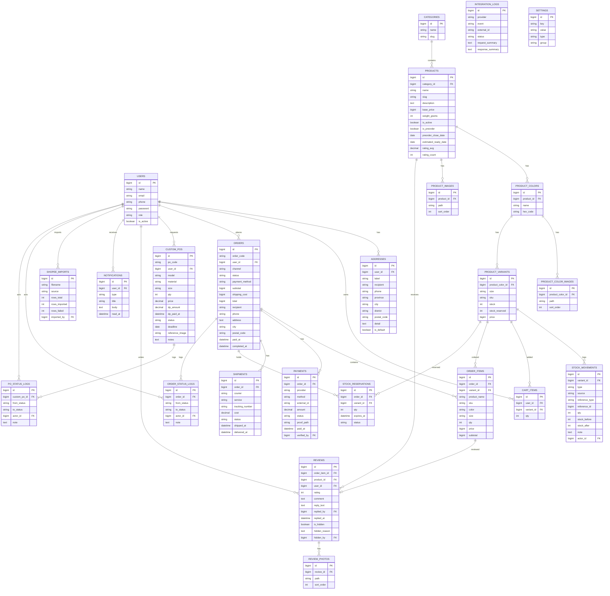

# ERD Fase 1 — The Things Corner

**Versi:** 0.5  
**Tanggal:** 11 November 2026  
**Status:** Draft, schema katalog mengikuti implementasi warna dan varian  
**Referensi:** PRD Fase 1 v0.2, RFP v0.3

---

## 1. Cara membaca

- `PK` = primary key.
- `FK` = foreign key.
- `1 ── N` = satu ke banyak.
- `1 ── 1` = satu ke satu.
- Tabel `status_logs` bersifat append-only: tidak diubah atau dihapus.
- Tabel `stock_movements` juga append-only.
- Semua tabel memakai `created_at` dan `updated_at`, kecuali log yang hanya memakai `created_at`.

---

## 2. ERD



---

## 3. Tabel dan fungsi

| Entitas | Fungsi | Constraint penting |
|---|---|---|
| `users` | Akun pembeli, Admin Biasa, Admin Master | `email` unik; `role` enum |
| `addresses` | Alamat pembeli | `user_id` FK; satu alamat default per user |
| `categories` | Kategori produk | `slug` unik |
| `products` | Produk | `slug` unik; `category_id` FK; `base_price`, `is_active`, preorder |
| `product_colors` | Warna per produk | unik `(product_id, name)`; `hex_code` opsional |
| `product_color_images` | Foto per warna | `product_color_id` FK; path di disk public |
| `product_variants` | Varian ukuran per warna | `sku` unik; unik `(product_color_id, size)`; `stock >= 0` |
| `product_images` | Foto umum produk | `product_id` FK; path di disk public; urut `sort_order` |
| `stock_movements` | Riwayat mutasi stok | append-only; `variant_id` FK; `actor_id` FK |
| `cart_items` | Keranjang persisten | unik `(user_id, variant_id)` |
| `stock_reservations` | Stok ditahan saat checkout | `order_id`, `variant_id` FK; index `(expires_at, status)` |
| `orders` | Pesanan web/Shopee | `order_code` unik; `user_id` FK |
| `order_items` | Item pesanan | `order_id`, `variant_id` FK; snapshot harga |
| `payments` | Pembayaran | `external_id` unik; `order_id` FK; `verified_by` FK |
| `shipments` | Pengiriman | `order_id` FK |
| `order_status_logs` | Riwayat status pesanan | append-only; `order_id`, `actor_id` FK |
| `custom_pos` | Custom PO | `po_code` unik; `user_id` FK |
| `po_status_logs` | Riwayat status PO | append-only; `custom_po_id`, `actor_id` FK |
| `reviews` | Review produk | unik `order_item_id`; `product_id`, `user_id` FK |
| `review_photos` | Foto review | `review_id` FK |
| `notifications` | Pusat notifikasi | `user_id` FK |
| `shopee_imports` | Riwayat import CSV | `imported_by` FK |
| `integration_logs` | Log integrasi | tanpa secret |
| `settings` | Pengaturan toko | `key` unik |

---

## 4. Relasi dan aturan hapus

| Relasi | Jenis | Aturan hapus |
|---|---|---|
| `users → addresses` | 1:N | cascade |
| `users → orders` | 1:N | restrict |
| `users → custom_pos` | 1:N | restrict |
| `users → reviews` | 1:N | restrict |
| `users → notifications` | 1:N | cascade |
| `categories → products` | 1:N | restrict |
| `products → product_colors` | 1:N | cascade |
| `product_colors → product_variants` | 1:N | cascade |
| `product_colors → product_color_images` | 1:N | cascade |
| `products → product_images` | 1:N | cascade |
| `product_variants → stock_movements` | 1:N | restrict |
| `product_variants → cart_items` | 1:N | cascade |
| `product_variants → order_items` | 1:N | restrict |
| `product_variants → stock_reservations` | 1:N | restrict |
| `orders → order_items` | 1:N | restrict |
| `orders → payments` | 1:N | restrict |
| `orders → shipments` | 1:N | restrict |
| `orders → stock_reservations` | 1:N | cascade |
| `orders → order_status_logs` | 1:N | cascade |
| `order_items → reviews` | 1:0..1 | restrict |
| `reviews → review_photos` | 1:N | cascade |
| `custom_pos → po_status_logs` | 1:N | cascade |

Catatan:

- Pesanan, pembayaran, dan mutasi stok **tidak boleh dihapus** karena merupakan riwayat.
- Produk/varian yang sudah dipakai transaksi hanya dinonaktifkan.
- `restrict` mencegah data historis kehilangan referensi.

---

## 5. Index yang disarankan

| Tabel | Index | Alasan |
|---|---|---|
| `users` | `email` unik | Login |
| `product_variants` | `sku` unik | Pencarian dan import Shopee |
| `product_variants` | `(product_id, size, color)` | Daftar varian |
| `stock_movements` | `(variant_id, created_at)` | Kartu stok |
| `orders` | `order_code` unik | Referensi pesanan |
| `orders` | `(user_id, created_at)` | Riwayat pembeli |
| `orders` | `(status, created_at)` | Antrean admin |
| `payments` | `external_id` unik | Idempotency webhook |
| `stock_reservations` | `(expires_at, status)` | Scheduler kedaluwarsa |
| `reviews` | `order_item_id` unik | Satu review per item |
| `reviews` | `(product_id, is_hidden)` | Rating produk |
| `notifications` | `(user_id, read_at)` | Pusat notifikasi |
| `shopee_imports` | `(source, created_at)` | Riwayat import |

---

## 6. Enum status

### 6.1 Order

```text
MENUNGGU_PEMBAYARAN
DIBAYAR
MENUNGGU_KONFIRMASI
DIKEMAS
DIKIRIM
SELESAI
DIBATALKAN
KEDALUWARSA
```

### 6.2 Payment

```text
PENDING
PAID
EXPIRED
FAILED
REFUNDED
```

### 6.3 Shipment

```text
PENDING
PICKUP
IN_TRANSIT
DELIVERED
RETURNED
```

### 6.4 Custom PO

```text
DIAJUKAN
DITINJAU
MENUNGGU_DP
PRODUKSI
SELESAI_PRODUKSI
MENUNGGU_PELUNASAN
DIKIRIM
SELESAI
DIBATALKAN
```

### 6.5 Review

```text
PUBLISHED
HIDDEN
```

---

## 7. Keputusan yang masih terbuka

| Topik | Pilihan | Dampak |
|---|---|---|
| Model stok | Satu pool / terpisah per kanal / alokasi | Menambah kolom atau tabel alokasi |
| Satu PO | Satu pasang / banyak pasang | Jika banyak, perlu `custom_po_items` |
| Provider payment | Midtrans / Xendit | Struktur `payments` tetap generik |
| Multi-alamat UI | Fase 1 satu default / langsung banyak | Struktur `addresses` sudah mendukung |
| Retur | Manual / otomatis | Fase 1 manual; tidak ada tabel retur |
| Shopee API | Fase 2 | Tidak mengubah tabel inti |
| Foto produk | Local public / S3 | Kode sekarang local public; path lama di Neon masih menunjuk S3 dan perlu disalin |
| Brand | `Thethingscorner` | Sudah dikonfirmasi 12 November 2026 |

---

## 8. Sample data

Contoh data ada di `docs/data/`:

- 10 produk;
- 30 varian;
- 10 pesanan;
- 3 custom PO;
- 3 review;
- 8 baris pesanan Shopee;
- mutasi stok, pembayaran, dan pengiriman.

Gunakan data ini untuk menguji ERD dan UI sebelum data client tersedia.

Field lanjutan yang sudah ditambahkan 11 November 2026:

- `products.weight_grams`
- `products.rating_avg`
- `products.rating_count`
- `product_variants.stock_reserved`
